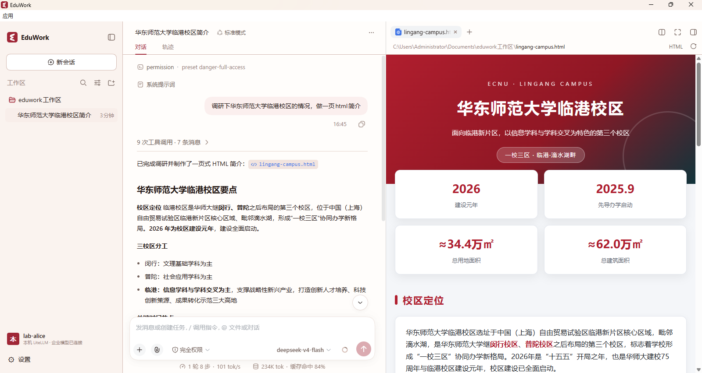

  

<h1 align="center">EduWork</h1>

<strong>基于 DSH 的教育发行版。</strong> 机构接入 · 资料创作 · 插件与技能

  

**简体中文** | [English](README_EN.md)

[项目官网](https://ecnu.github.io/EduWork/) · [预装插件](#随包插件) · [安装与使用](#安装与使用) · [数据与隐私](#数据与隐私) · [详细文档](#详细文档) · [Roadmap 讨论](https://github.com/ECNU/EduWork/issues/95)

EduWork 基于 [DeepSeek Harness（DSH）](https://github.com/deepseek-ai/deepseek-harness)，为教学、科研与办公组合插件、技能和桌面运行环境。围绕本机资料开展对话、创作和学习，可以连接个人模型服务，也可以使用兼容的学校或企业账号登录。

**公版已关闭 DSH 的额外会话日志、产品操作与设备埋点、插件清单及官方会话反馈上传。** 正常模型与工具调用仍会向所选服务发送任务所需内容，详见[数据与隐私](#数据与隐私)。

## 从 DSH 到学校发行版

DSH 提供 Agent 运行时与插件体系；EduWork 复用上游的会话、工具、浏览器与文件能力，维护教育场景的公共组合。学校与机构通过配置和插件接入自己的模型、业务服务和品牌。[EduWork@ECNU](https://github.com/ECNU/EduWork-ECNU) 是其中一个实践。

## 随包插件

以下插件随公版安装。批注、侧聊、文献、邮件、远程访问和外部智能体可在左侧 **插件 → EduWork 扩展** 中单独启停；关闭插件会保留配置和数据。点击插件名称查看使用方法。

<!-- BEGIN GENERATED PLUGINS -->
| 插件 | 能做什么 |
| --- | --- |
| [机构登录与模型接入](packages/dsh-oidc/README.md) | 通过浏览器登录兼容的机构网关，发现模型并自动续期。支持 LiteLLM OAuth 与实验性 oidc-llm 接入。 |
| [Knowledge Studio](packages/dsh-knowledge-studio/README.md) | 把资料变成报告、演示、思维导图、测验与闪卡；配套成果服务提供 Office 预览和媒体制作，与对话共用。 |
| [选段批注](packages/dsh-annotation/README.md) | 选中回复片段添加批注，保留来源编号，多条一起发送；复用 DSH 的输入框与草稿。 |
| [侧边聊天](packages/dsh-side-chat/README.md) | 从消息或选区开启侧聊，带着历史快照继续提问；与主会话分别进行，关闭后归档。可与批注插件联动。 |
| [决策工具](packages/dsh-decision/README.md) | 通过 SystemOne 服务按标签分类、判断条件概率或按量表评分，配套决策技能；配置服务地址、模型和认证后启用。 |
| [文献检索](packages/dsh-literature/README.md) | 检索 DBLP、arXiv 文献，获取 BibTeX 与可用全文，把研究资料接入后续任务。 |
| [本地记忆](packages/dsh-memory/README.md) | 管理本地记忆、检索历史对话，让后续任务接得上已有背景。记忆在本机管理。 |
| [邮件助手](packages/dsh-mail/README.md) | 通过 IMAP 查信、经授权用 SMTP 发信。可在设置中开启新邮件提醒，查看发件人、主题和正文片段，不改变邮件已读状态。 |
| [日历与日程](dsh-plugins/calendar/README.md) | 在月历或周历安排日程、设置重复与提醒，也可在对话中添加日程。支持 ICS 导入、导出和订阅；接入机构校历后可查看教学周和学年总览。 |
| [桌面宠物](packages/dsh-desktop-pet/README.md) | 让桌宠提示任务状态和插件通知，例如新邮件。在设置中开启桌宠、选择形象；邮件提醒在邮件助手中单独开启。 |
| [外部智能体](packages/dsh-external-agents/README.md) | 连接本机 Codex、Cursor 或其他 ACP 智能体，在对话中委派任务。默认关闭，可在插件页启用并配置连接。 |
| [远程访问](packages/dsh-remote-access/README.md) | 通过中继配对手机或另一台电脑，在浏览器里继续本机会话、处理审批。公版需先配置并测试中继；机构发行版可预设中继和账号登录。 |
<!-- END GENERATED PLUGINS -->

插件也以独立 npm 包维护，可按各自兼容范围供其他 DSH 应用复用。外部模型、邮箱和媒体服务需自行配置；公版不附带模型额度或私人凭据。

### 随包技能

技能负责引导任务方法，调用插件与工具完成工作。内置文档、演示、表格、PDF、图像、语音、视频、Studio、浏览器及技能创作等指引，可在设置中启停或导入自己的技能。对话与 Studio 共用创作能力，图像和云端语音需配置相应服务。[使用指南](docs/USER_GUIDE.md) · [媒体配置](docs/MEDIA.md)

## 安装与使用

桌面包支持 **Windows x64**、**macOS 15+ Apple Silicon（arm64）和 Intel（x64）**。每位用户在自己的电脑上运行，普通本地使用无需额外部署 EduWork 服务端。

### 1. 获取客户端

从 [最新稳定版](https://github.com/ECNU/EduWork/releases/latest) 下载对应平台的桌面包：

- **Windows**：下载 `setup.zip`，解压后运行安装程序，选择可写的新目录。也可下载完整 Electron ZIP，全部解压后运行 `EduWork-Electron.exe`，保留同目录资源文件。
- **macOS**：按芯片选择 arm64 或 x64 的 DMG，将应用拖入“应用程序”后打开；也可使用对应 ZIP。首次打开的系统安全提示见 [macOS 说明](docs/MACOS.md)。

Release 中的 Source code 是源码，不是桌面安装包。从源码运行见[构建指南](docs/BUILD.md)。

### 2. 连接模型

| 你已有的服务 | 如何开始 |
| --- | --- |
| 个人模型 API | 打开 **设置 → 模型**，填写 API Key、接口地址和模型。 |
| LiteLLM 网关账号 | 在 **设置 → 打开配置文件** 中参照 `examples/litellm.jsonc` 添加机构，再通过浏览器登录。[配置指南](packages/dsh-oidc/docs/gateway-auth/litellm-setup.md) |
| 学校或企业提供的配置 | 把机构条目合并到生效 `eduwork.jsonc` 的 `organizations`，保存后完全退出并重启，再选择机构登录。[配置示例](config/desktop/examples/README.md) |

以设置中打开的配置文件为准；只修改示例文件不会生效。机构接入、媒体服务和更新源等集中在 `eduwork.jsonc`，个人 API Key 在模型设置中管理。配置文件仅放公开接入信息与凭据引用，不填写密码或登录 Token。

### 3. 开始工作

选一个本机文件夹作为工作区，把讲义放进去，试着问：**“根据这份讲义生成一份学习指南，再出五道自测题。”** 可以在右侧 Studio 预览成果，选中回复中的一段添加批注，或开侧聊单独追问。需要查阅网页时，可让 Agent 在当前对话的侧栏浏览器中查看页面、点击或填写表单，沿用会话的审批设置。

首次启动有新手引导。以后想再看快速入门，从 **应用 → 使用教程** 打开即可（macOS 在系统菜单栏的应用菜单里）；随包教程可离线阅读。

关闭窗口后默认收起到托盘；彻底退出请用托盘或应用菜单。在设置中开启软件更新后，客户端会定期检查所选渠道，电脑唤醒或恢复联网时也会补查；更新保留历史数据和配置。详见 [Windows 更新说明](docs/UPDATES.md)和 [macOS 更新说明](docs/MACOS_UPDATES.md)。

## 机构接入与共建

只需连接模型时，提供配置即可；需要专属业务时，再增加插件与技能。机构可沿用 LiteLLM 原生 OAuth，也可参与实验性的 oidc-llm 开放接入草案。账号、模型授权和配额由相应服务管理。

[机构登录插件](packages/dsh-oidc/README.md) · [开放接入倡议](packages/dsh-oidc/docs/open-integration.md) · [oidc-llm 草案](packages/dsh-oidc/docs/gateway-auth/oidc-llm-draft.md) · [机构发行边界](docs/EDITIONS.md)

欢迎贡献代码、插件、技能、文档和使用经验。[贡献指南](CONTRIBUTING.md) · [需求与反馈](https://github.com/ECNU/EduWork/issues) · [Roadmap 讨论](https://github.com/ECNU/EduWork/issues/95) · [推荐 Skills](https://github.com/ECNU/EduWork/issues/126) · [推荐插件](https://github.com/ECNU/EduWork/issues/127)

## 详细文档

| 文档 | 内容 |
| --- | --- |
| [使用指南](docs/USER_GUIDE.md) | 模型、搜索、语音、文件操作与故障诊断。 |
| [配置文件](docs/CONFIGURATION.md) · [配置示例](config/desktop/examples/README.md) | 机构登录、品牌、媒体服务与更新源。 |
| [插件文档](#随包插件) · [媒体配置](docs/MEDIA.md) | 各插件的功能、使用方法和服务条件。 |
| [版本与升级](docs/RELEASE.md) · [历史数据导入](docs/数据导入.md) | 版本渠道、升级及数据迁移。 |
| [配置与 Skills 更新](docs/CONTENT_UPDATES.md) | 独立更新机构配置与官方技能。 |
| [构建指南](docs/BUILD.md) · [macOS 说明](docs/MACOS.md) | 源码运行、桌面装配与平台适配。 |
| [插件包维护](docs/PACKAGES.md) · [贡献指南](CONTRIBUTING.md) | 扩展开发与参与方式。 |

## 数据与隐私

会话、工作区引用和记忆在本机管理。公版发行包通过[装配策略](dsh-host/distribution-policy.mjs)关闭以下 DSH 上报能力；策略在启动和配置重载时生效，无需用户另行关闭：

| 上报能力 | 公版策略 |
| --- | --- |
| 额外会话日志 | 关闭随原生 DeepSeek 模型请求附加的会话日志上传。 |
| 产品操作与设备埋点 | 关闭官方产品行为及设备信息埋点上报。 |
| 插件清单 | 关闭插件包名称、版本清单上报。 |
| 官方会话反馈 | 关闭官方反馈入口及其会话上下文上传通道。 |

**正常服务调用仍会联网。** 使用远程模型、搜索、邮件、媒体或其他联网工具时，相应服务会收到完成任务所需的数据。模型适配器仍可能携带所选协议的请求标识；上述策略不改变正常 API 请求，也不表示完全匿名。数据处理规则以所选服务为准，自行添加的插件或调整过的发行组合需核对其实际行为。

**诊断文件由用户决定是否分享。** 导出诊断 ZIP 或 Session log 不会自动提交给维护者；Session log 可能包含对话与工具结果，分享前请检查内容，见[使用指南](docs/USER_GUIDE.md#故障诊断)。跨机迁移时，客户端目录之外的工作区文件需另行复制。截图采用演示资料。

## 许可

EduWork 项目原创贡献采用[木兰宽松许可证第 2 版](LICENSE)；历史 MIT 代码及许可边界见[许可范围](LICENSING.md)，基于 [DeepSeek Harness](https://github.com/deepseek-ai/deepseek-harness) 构建；Knowledge Studio 的资料创作与学习交互受 NotebookLM 启发。第三方组件保留各自许可证，见[第三方声明](THIRD_PARTY_NOTICES.md)。

## Star 趋势

<a href="https://www.star-history.com/?repos=ECNU%2FEduWork&amp;type=date">
  <picture>
    <source media="(prefers-color-scheme: dark)" srcset="https://api.star-history.com/chart?repos=ECNU/EduWork&amp;type=date&amp;theme=dark" />
    <source media="(prefers-color-scheme: light)" srcset="https://api.star-history.com/chart?repos=ECNU/EduWork&amp;type=date" />
    
  </picture>
</a>
