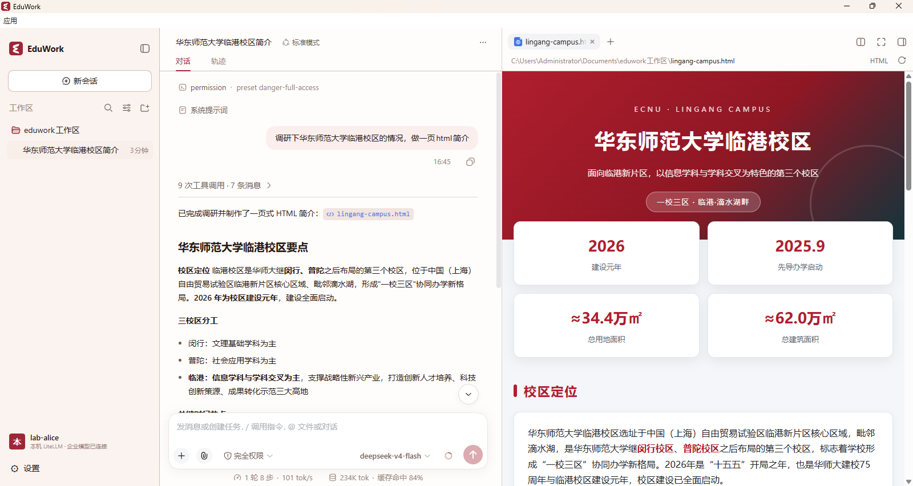

  

<h1 align="center">EduWork</h1>

<strong>An education distribution built on DSH.</strong> Institution access · Create from your materials · Plugins & skills

  

[简体中文](README.md) | **English**

[Website](https://ecnu.github.io/EduWork/?lang=en) · [Bundled plugins](#bundled-plugins) · [Installation & use](#installation-and-use) · [Documentation](#documentation) · [Roadmap discussion](https://github.com/ECNU/EduWork/issues/95)

EduWork builds on [DeepSeek Harness (DSH)](https://github.com/deepseek-ai/deepseek-harness), combining plugins, skills and a desktop environment for teaching, research and office work. Chat, create and learn with local materials, using your own model service or a compatible school or organization account.

## From DSH to institution editions

DSH provides the agent runtime and plugin system. EduWork reuses its conversations, tools, browser and file capabilities and maintains a shared distribution for education. Institutions connect their own models, services and branding through configuration and plugins. [EduWork@ECNU](https://github.com/ECNU/EduWork-ECNU) is one example.

## Bundled plugins

These plugins come with the public desktop edition. Follow each link for usage, service requirements and compatibility.

<!-- BEGIN GENERATED PLUGINS -->
| Plugin | What it does |
| --- | --- |
| [Identity & model access](packages/dsh-oidc/README_EN.md) | Sign in to a compatible gateway through your browser, discover models and renew tokens. Supports LiteLLM OAuth and experimental oidc-llm integration. |
| [Knowledge Studio](packages/dsh-knowledge-studio/README_EN.md) | Turn materials into reports, presentations, mind maps, quizzes and flashcards, with companion artifact services for Office previews and media creation shared with conversations. |
| [Response annotations](packages/dsh-annotation/README_EN.md) | Comment on selected passages, keep numbered references and send multiple annotations together using DSH’s composer and drafts. |
| [Literature search](packages/dsh-literature/README_EN.md) | Search DBLP and arXiv, retrieve BibTeX and available full text, and bring research sources into your next task. |
| [Local memory](packages/dsh-memory/README_EN.md) | Manage local memory and search past conversations so new tasks can pick up existing context. Memories are managed on your machine. |
| [Mail assistant](packages/dsh-mail/README_EN.md) | Connect your mailbox, read mail over IMAP and send through SMTP with authorization, bringing communication into your workflow. |
| [Desktop pet](packages/dsh-desktop-pet/README_EN.md) | Show task and notification status through a choice of companions. Enable it in settings; this npm plugin requires the EduWork desktop bridge. |
| [Remote access](packages/dsh-remote-access/README_EN.md) | Pair another device to continue local sessions and handle approvals in its browser. Deploy a relay and configure its address and access key before enabling connections. |
<!-- END GENERATED PLUGINS -->

Plugins are also maintained as independent npm packages for compatible DSH applications. Configure external models, mailboxes and media services as needed; the public edition does not include model credits or private credentials.

### Bundled skills

Skills guide tasks using plugins and tools. Built-in guidance covers documents, presentations, spreadsheets, PDFs, images, speech, video, Studio, browsing and skill creation. Enable or disable skills in settings, or import your own. Conversations and Studio share creation capabilities; images and cloud speech need configured services. [User guide](docs/USER_GUIDE.md) · [Media setup](docs/MEDIA.md)

## Installation and use

Desktop packages support **Windows x64** and **macOS 15+ on Apple Silicon (arm64) and Intel (x64)**. Each user runs EduWork on their own computer; ordinary local use needs no additional EduWork server.

### 1. Get the client

Download the appropriate desktop package from the [latest stable release](https://github.com/ECNU/EduWork/releases/latest):

- **Windows**: download `setup.zip`, extract it, run the installer and choose a new writable directory. Alternatively, extract the complete Electron ZIP and run `EduWork-Electron.exe`, keeping all accompanying resources.
- **macOS**: choose the arm64 or x64 DMG for your processor and drag the app into Applications. A matching ZIP is also available. See the [macOS guide](docs/MACOS.md) for first-launch security prompts.

The Source code downloads are source archives, not desktop installers. See the [build guide](docs/BUILD.md) to run from source.

### 2. Connect a model

| Your service | How to start |
| --- | --- |
| Personal model API | Open **Settings → Models** and enter your API key, endpoint and model. |
| LiteLLM gateway account | Open **Settings → Open configuration file**, add your organization using `examples/litellm.jsonc`, then sign in through your browser. [Setup guide](packages/dsh-oidc/docs/gateway-auth/litellm-setup.en.md) |
| School or organization configuration | Merge the organization entry into `organizations` in the active `eduwork.jsonc`, save, fully quit and restart, then sign in. [Configuration examples](config/desktop/examples/README_EN.md) |

Use the configuration file opened from settings; changing an example alone has no effect. Institution access, media services and update feeds live in `eduwork.jsonc`; personal API keys are managed in model settings. Put only public connection information and credential references in the configuration file, not passwords or login tokens.

### 3. Start working

Choose a local workspace, add your materials, select a model and describe your goal. Try: **“Create a study guide from these materials, then make a quiz to go with it.”** You can also open Studio on the right and choose an artifact type. Preview generated files, annotate passages in replies and ask follow-up questions.

Closing the window keeps the app in the tray by default; use the tray or application menu to quit fully. Software updates can be toggled in settings and preserve history and configuration. See the [Windows update guide](docs/UPDATES.md) and [macOS update guide](docs/MACOS_UPDATES.md).

## Institution access and contribution

Configuration is enough to connect models; add plugins and skills for institution-specific services. Institutions can use native LiteLLM OAuth or explore the experimental oidc-llm open integration draft. The connected service manages accounts, model access and quotas.

[Identity plugin](packages/dsh-oidc/README_EN.md) · [Open integration initiative](packages/dsh-oidc/docs/open-integration.en.md) · [oidc-llm draft](packages/dsh-oidc/docs/gateway-auth/oidc-llm-draft.en.md) · [Edition boundaries](docs/EDITIONS.md)

Contribute code, plugins, skills, documentation or practical experience. [Contributing](CONTRIBUTING.md) · [Issues & feedback](https://github.com/ECNU/EduWork/issues) · [Roadmap discussion](https://github.com/ECNU/EduWork/issues/95) · [Suggest a skill](https://github.com/ECNU/EduWork/issues/126) · [Suggest a plugin](https://github.com/ECNU/EduWork/issues/127)

## Documentation

| Guide | Contents |
| --- | --- |
| [User guide](docs/USER_GUIDE.md) | Models, search, speech, files and troubleshooting. |
| [Configuration](docs/CONFIGURATION_EN.md) · [Examples](config/desktop/examples/README_EN.md) | Institution login, branding, media and update feeds. |
| [Plugin documentation](#bundled-plugins) · [Media setup](docs/MEDIA.md) | Plugin features, usage and service requirements. |
| [Versions and upgrades](docs/RELEASE.md) · [History import](docs/数据导入.md) | Release channels, upgrades and data migration. |
| [Configuration and skill updates](docs/CONTENT_UPDATES.md) | Update institution configuration and official skills independently. |
| [Build guide](docs/BUILD.md) · [macOS guide](docs/MACOS.md) | Source development, desktop assembly and platform support. |
| [Package maintenance](docs/PACKAGES_EN.md) · [Contributing](CONTRIBUTING.md) | Extension development and participation. |

## Data and privacy

Conversations, workspace references and memories are managed locally. Remote models, search and media services receive the content needed for a task; their data policies apply. When moving to another computer, copy workspace files outside the client directory separately. For troubleshooting, export a diagnostic ZIP or session log as described in the [user guide](docs/USER_GUIDE.md). Screenshots use demo materials.

## License

EduWork code is [MIT licensed](LICENSE) and built on [DeepSeek Harness](https://github.com/deepseek-ai/deepseek-harness). Knowledge Studio’s source-based creation and learning interactions are inspired by NotebookLM. Third-party components retain their own licenses; see [third-party notices](THIRD_PARTY_NOTICES.md).

## Star History

<a href="https://www.star-history.com/?repos=ECNU%2FEduWork&amp;type=date">
  <picture>
    <source media="(prefers-color-scheme: dark)" srcset="https://api.star-history.com/chart?repos=ECNU/EduWork&amp;type=date&amp;theme=dark" />
    <source media="(prefers-color-scheme: light)" srcset="https://api.star-history.com/chart?repos=ECNU/EduWork&amp;type=date" />
    
  </picture>
</a>
