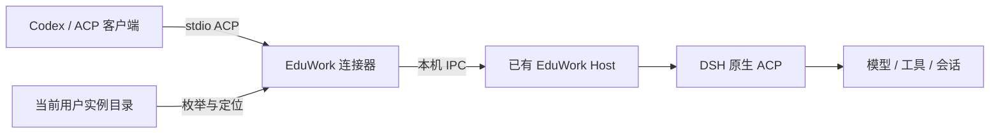

# EduWork 原生 ACP 接入提案

状态：Draft，待评审。本文定义最小版本与后续路线；配置字段、命令和界面均为提案，尚未随产品提供。

## 目标与现有基础

让 Codex 和其他 ACP 客户端发现并连接本机已运行的 EduWork，复用该实例的模型、工具和会话生命周期。首版支持当前产品锁定的 DSH 原生 ACP，连接器只转发协议流，Host 由 EduWork 管理。

产品目前选用 DSH `0.2.2-rc.1`，见 [内核集成](CORE-022.md)。入站接入与 `dsh-external-agents` 的方向相反：前者由其他客户端调用 EduWork，后者由 EduWork 调用外部 Agent。两者可以共存。

已有原型验证了在运行中的 Host 内加载原生 ACP、通过本地通道接收 stdio 转发，以及 initialize、创建、prompt、取消、关闭和恢复会话。工具可经 Host 的工具流水线执行。该验证支持协议路径可行，产品仍需实现稳定的安装入口、实例发现、权限交互和界面集成。

当前原生语义影响产品设计：

- `session/list` 返回可恢复的持久化根会话；已挂载的会话可能不在列表中，已被占用的会话不能再次恢复。
- ACP 创建的会话会持久化，但不会自动挂到桌面工作区，普通侧栏未必显示。
- 当前接入支持 resume，不提供 `session/load` 和历史消息回放。
- 原生 `agentInfo` 使用 DSH 身份。EduWork 品牌身份需要上游扩展点或兼容实现，并进行协议验收。

这些行为需按产品实际锁定的 DSH 版本复核。

## 最小版本：启用、发现、连接



### 1. 单一配置入口

沿用 [eduwork.jsonc](CONFIGURATION.md) 的生效与更新规则，建议新增以下可选配置：

```jsonc
{
  "agentInterop": {
    "acp": {
      "enabled": false
    }
  }
}
```

缺省关闭；首版保存后重启生效。启用时在现有 Host 内注册原生 ACP 服务并发布实例记录；关闭时撤销监听与记录。升级保留用户选择。设置页提供同一开关、状态和“复制客户端配置”，不增加另一份生效配置。

首版只开放当前用户的本机连接。Windows 使用命名管道；其他平台的 Unix socket 需分别实现并验收后再宣布支持。

### 2. 本机实例发现

建议随产品提供稳定命令，以下是目标接口：

```text
eduwork instances --json
eduwork acp connect --instance <instance-id>
```

`instances` 枚举当前用户注册目录中的启用实例，并探测连接是否可用。使用安装/数据根标识生成稳定 `instanceId`，显示名允许重复；重启产生新的运行标识。多个实例必须显式选定 ID，不能只按窗口标题或工作区名称选择。

实例条目建议包含以下公开发现字段：

| 字段 | 用途 |
| --- | --- |
| `schemaVersion` | 发现记录格式版本 |
| `instanceId`、`displayName` | 稳定实例身份与展示名称 |
| `productVersion`、`dshVersion` | 产品与内核兼容性诊断 |
| `status` | 本次探测的在线状态 |
| `connection.command`、`connection.args` | 可交给 ACP 客户端的 stdio 启动配置 |

IPC 地址与运行标识保存在当前用户可访问的私有记录中；公开枚举不包含凭据。记录原子写入，正常退出时删除本次运行的记录，异常退出的记录在探测时标记离线；清理时核对运行标识，避免旧进程删除新进程记录。PID 只用于辅助诊断，连接握手必须校验实例和运行标识。

本机发现是 EduWork 的约定。ACP 的 `initialize` 在连接后协商身份与能力，不能代替连接前的实例定位。

### 3. 连接与协议识别

连接器向 stdout 只输出 ACP JSON-RPC，诊断写 stderr。实例离线、未启用或 ID 不明确时返回非零退出码，不自动启动 Host。路径含空格时仍通过独立的 command/args 参数传递。

ACP 客户端配置示意如下；实际格式由客户端决定，“复制客户端配置”应输出本机真实绝对路径：

```json
{
  "command": "<EduWork连接器绝对路径>",
  "args": ["acp", "connect", "--instance", "<instance-id>"]
}
```

连接成功后使用标准 `initialize`。只声明当前实现的版本与能力；EduWork 的 name/title/version 待上游身份扩展点确认后加入，不能将本地发现字段冒充协议能力。

支持 ACP 的客户端直接配置命令。Codex 等可执行本地命令的 Agent 可通过薄 ACP 客户端调用同一连接器；客户端实现负责请求关联、流式更新、取消和权限响应，不把产品能力另行包装成私有任务协议。

### 4. 工具、审批与会话

模型和工具沿用实例配置，工具继续经过 Host 的执行与审批流水线。不得在接入层默认禁止所有工具，也不得自动同意所有权限请求。首版需要明确哪些审批由 ACP 客户端处理、哪些仍由桌面处理，以及客户端不支持审批时的失败提示，避免请求无限等待。

连接应仅管理自己持有的会话，禁止抢占桌面或其他连接正在使用的 Agent。连接中断时取消或释放本连接资源，保留持久化记录，不影响其他客户端。客户端传入的 MCP 挂载配置涉及新增工具来源，首版可显式拒绝，并提供可理解的错误；后续再提供授权入口。

首版保留原生会话归属行为，同时在接入状态说明中告知侧栏可见性。统一外部会话列表进入下一阶段，允许按实例、来源和会话 ID 定位，再由用户选择工作区关联。

## Roadmap 与验收

| 阶段 | 交付 | 完成条件 |
| --- | --- | --- |
| M0：当前提案 | 架构、接口约定、原生限制、评审问题 | 维护者确认范围与上游依赖 |
| M1：Windows 最小版本 | 配置开关、Host 内 ACP、实例目录、stdio 连接器、客户端配置导出 | 单实例与多实例端到端通过，关闭可撤销连接入口 |
| M2：会话与权限体验 | 外部会话列表、来源与状态、审批衔接、工作区关联、成果入口 | 用户可找到会话、处理审批、打开成果；断连无悬挂审批 |
| M3：客户端与平台覆盖 | macOS/Linux 传输、客户端示例、兼容性矩阵 | 每个平台和客户端有真实端到端验收 |
| M4：分发与远程评估 | 稳定连接器分发、ACP Registry 评估、远程协议评估 | 独立确认认证、版本兼容与运维设计后实施 |

M1 必须通过以下检查后才能称为最小可运行版本：

1. 默认关闭时没有入口和可连接记录；启用后连接到原 Host，Host 数量不增加。
2. 两个同名实例得到不同 ID，准确选择，离线实例不会误连；覆盖重启与陈旧记录。
3. initialize、新建、prompt 流式输出、取消、关闭及恢复完成真实调用；能力声明与实际一致。
4. 至少一个实际工具调用完成；需要审批的调用可批准、拒绝或取消，桌面会话不受影响。
5. 客户端异常退出、Host 退出和关闭开关后，监听、会话所有权及审批资源按定义释放。
6. 路径含空格、无模型配置、协议版本不兼容、实例忙、缺少权限均返回清晰错误；stdout 保持纯协议。
7. 合成自动测试覆盖发现、传输与生命周期；真实模型与桌面验收单独记录，仓库不提交个人会话或机器路径。

## 希望维护者确认

- 是否采用 `agentInterop.acp.enabled` 和独立的实例发现命令，以及连接器在安装包中的稳定位置。
- Host 内原生 ACP 生命周期、品牌身份及审批衔接，哪些扩展点应由 DSH 上游提供。
- M1 保留原生工作区归属、M2 增加可见会话入口的分阶段安排是否合适。

## 协议参考

- [ACP 初始化与身份能力协商](https://agentclientprotocol.com/protocol/v1/initialization)
- [ACP 传输](https://agentclientprotocol.com/protocol/v1/transports)
- [ACP Registry](https://agentclientprotocol.com/get-started/registry)：用于客户端发现可安装的 Agent；本机运行实例仍需自身发现机制。
