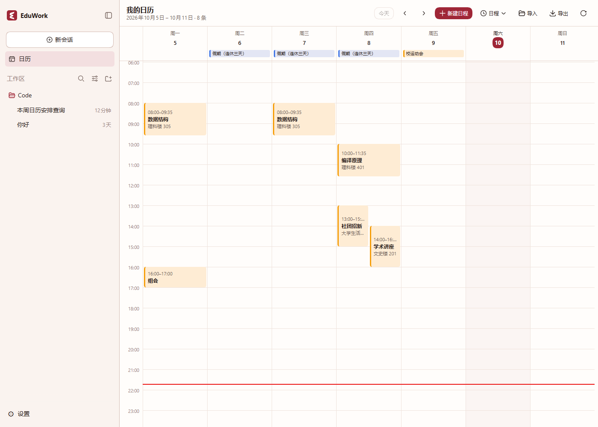

# Calendar and schedule module proposal

[简体中文](README.md) | **English**

Status: the public calendar, personal settings, source registration and pushed updates and Agent tools are implemented. Reminder planning, a durable inbox and optional system notification delivery are implemented without starting a model; real school fetching remains unintegrated. See the plugin [README](../../../dsh-plugins/calendar/README_EN.md) and [integration guide](INTEGRATION_EN.md).

Ownership: public edition (EduWork). Institution data integration is a separate proposal; see [Institution boundary](#institution-boundary).

## Goal

Introduce a standalone calendar and schedule plugin in the public edition: week/month views, local event and private-note storage, ICS import and export, and an **open data structure** that the institution edition can use to inject school data (academic calendar, class timetable). A timetable is one data source for the calendar module, not a public-edition concept of its own.

The plugin can be used by other DSH applications without installing the EduWork desktop client. It adds no runtime dependency and does not depend on institution credentials, private networks or an adjacent institution repository.

## Plugin identity

| Item | Value |
| --- | --- |
| Release identifier | `eduwork-calendar` |
| Package name | `@eduwork/dsh-calendar` |
| Source | `dsh-plugins/calendar` |
| Panel identifier | `calendar` |
| Form | Built-in source extension: built from source during assembly, not published as a separate npm package |

Naming: in the public edition this capability is a calendar and schedule, not one school's timetable; timetables and academic calendars are data sources for it. Upstream already provides `@deepseek-ai/dsh-schedule` (reminder engine) and `@deepseek-ai/dsh-client-ui-schedule` (read-only reminder list in the conversation header), so this plugin avoids the `schedule` name to prevent conceptual overlap.

Optionality: public-edition plugins are installed with the release by default. This plugin declares itself **removable without intruding on the core**, following the existing UI extensions (`chatecnuWork` in `package.json`: `kind` is `ui-extension`, `removable` is true, `uses` lists the slots it occupies). Removing it does not affect chat, Studio or other capabilities. Whether a user-facing toggle exists is decided by existing settings capability and is outside this proposal.

## Scope

Included:

| Capability | Description |
| --- | --- |
| Week/month views | Arrange time by week or browse a month, with navigation, today and source filtering |
| Private notes and Agent tools | Store notes separately; tools read and write events, descriptions and private notes |
| Local event storage | Events are kept on this machine and survive across sessions |
| ICS import and export | Parse and emit a minimal `VEVENT` set, matching common academic-calendar and timetable data |
| Open data structure | The event contract defined by the public edition, used by the institution edition to inject data |
| Sidebar entry | Reuses the existing `sidebar.panellist` and `main` slots (verified) |

Excluded:

| Item | Destination |
| --- | --- |
| Reminders triggered at a point in time | Separate proposal, see [Reminder boundary](#reminder-boundary) |
| Scraping the academic system, academic calendar, holiday shifts | Institution edition, see [Institution boundary](#institution-boundary) |
| Agenda view and dragging existing events | Later as needed |
| CalDAV, ICS subscription sync, meeting invitations | Out of scope |
| Lecture notes and other course attachments | Later milestone |

## Relationship to existing implementations

### Official foundation

| Package | Role | Relation to this document |
| --- | --- | --- |
| `@deepseek-ai/dsh-schedule` | Host-side reminder engine: one-off, fixed-interval and calendar-rule reminders that survive restarts | Foundation for reminders (separate proposal); this proposal does not duplicate scheduling |
| `@deepseek-ai/dsh-client-ui-schedule` | Read-only reminder list in the conversation header | Different responsibility from a calendar panel; it is not replaced |

Both cover only the existence and due time of reminders. Neither provides a calendar view, event storage or a data-injection entry point, so this proposal does not overlap with them.

### Third-party implementations

The survey is recorded in issue #48 (2026-09-27). Its conclusion: there is no ready-made timetable plugin, and no single implementation covers local storage, reminders, data injection and a week view at the same time. Relevant candidate types:

| Candidate type | Worth reusing | Concern about adopting it directly |
| --- | --- | --- |
| Multi-view calendars (week/month/agenda, drag and drop) | View layout and interaction design | Stops at an earlier DSH API line; single maintainer; brings its own data model and styling |
| Calendar toolkits centred on CalDAV and RRULE | Approach to ICS compatibility and RRULE expansion | Newer versions ship no UI; internal model differs from the open contract here |
| iCal subscription and early-reminder plugins | Product shape of subscription import | Depends on an external subscription source; reminder channel differs from this repository's notification contract |
| Holiday and lunar-calendar plugins | Source of holiday data | Academic calendars and holiday shifts must follow school data and belong to the institution edition |

Any candidate must be re-checked for licence, version line and maintenance status before adoption.

### Reuse paths and admission conditions

This repository already has four established reuse mechanisms. All four could carry calendar capability, with different admission conditions:

| Path | Precedent in this repository | Admission condition | Cost |
| --- | --- | --- | --- |
| Reference the design, implement it here | Several | None | No licence or version burden; work sits in the view and the contract |
| Vendor the source | `dsh-host/vendor/jsonc-parser` (keeps licence and README) | Keep licence and provenance, include in the source audit | Must follow upstream fixes over time |
| Fork as a standalone npm package | `@eduwork/dsh-literature`, forked from a third party and maintained here | Move into `packages/`, rename, adapt to the DSH baseline, **publish to npm**, add a component lock; maintainer involvement required | Heavier dependency and release flow |
| Runtime patch | Session-search backport | Record patch identity, package version and before/after SHA-256 | Only suitable for small fixes |

### Approach taken here: reuse the design, implement it here

This proposal argues for **reusing the design while implementing the code in this repository**:

- The survey itself points this way: no existing implementation covers local storage, reminders, data injection and a week view at the same time, and the most complete candidate covers more views and drag interactions but lacks the source and personal-data boundaries needed here.
- Adopting one directly would bring its licence, version line, dependency lock and the duty of following upstream along with it, while the things this proposal actually depends on — the open contract, the host-side injection entry point and notification integration — are not provided by any third party.
- Implementing it here can reuse the existing theme variables and UI primitives, so the styling matches the existing panels from the start instead of being adopted and then reworked.

What is reused: information structure and interaction only — how a week is laid out, how the current time and today are marked, what an event block shows, week navigation and the empty state. Visuals and code are written in this repository.

Constraints:

- Keep zero runtime dependencies, consistent with existing `dsh-plugins/` (none of them declares runtime `dependencies`).
- ICS and RRULE implement only the subset listed under [Recurrence boundary](#recurrence-boundary), following the survey's approach and adding no third-party parser.
- If maintainers prefer to reuse an existing implementation through a fork or vendoring, please name the candidate during review; we will open a separate proposal under the matching admission conditions above. That would change dependency locks and release arrangements.

## Event data structure

The core of the public contract. Fields follow ICS semantics so that no single data source is baked in.

| Field | Type | Required | ICS | Notes |
| --- | --- | --- | --- | --- |
| `uid` | string | yes | `UID` | Stable identifier within one source; use together with `source` |
| `title` | string | yes | `SUMMARY` | Title, for example "standup" or "health check"; in an injected timetable it is the course name |
| `start` | string | yes | `DTSTART` | Local time `YYYY-MM-DDTHH:mm`, or a date `YYYY-MM-DD` |
| `end` | string | no | `DTEND` | Inclusive for all-day events; timed ends must be later than starts and use the same format |
| `location` | string | no | `LOCATION` | Room or other place |
| `description` | string | no | `DESCRIPTION` | Event description exported to ICS, separate from private notes |
| `recurrence` | object | no | `RRULE` | See [Recurrence boundary](#recurrence-boundary) |
| `exceptions` | string[] | no | `EXDATE` | Cancelled instances |
| `source` | string | no | — | Source namespace, default `manual`; separate sources may share a `uid` |
| `originalStart` | string | No | — | Original identity of a moved non-recurring event; recurring instances derive it from the immutable baseline |
| `extensions` | object | no | `X-*` | Verbatim store for unrecognised fields |

Example (synthetic data):

```json
{
  "schemaVersion": 2,
  "events": [
    {
      "uid": "demo-event-1",
      "title": "Sample talk",
      "start": "2026-03-02T08:00",
      "end": "2026-03-02T09:35",
      "location": "Sample building 101",
      "recurrence": { "freq": "weekly", "count": 16, "byDay": ["mo"] },
      "source": "manual"
    }
  ]
}
```

Conventions:

- What this proposal asks for is an **open structure**: fields may be added, unrecognised fields are kept verbatim, the structure carries `schemaVersion`, and adding optional fields does not change the major version.
- Values use local dates or times. UTC input is converted to local time; unsupported external timezones are reported rather than silently accepted as local.
- Source identities must survive sign-in again; separate accounts need separate sources. Adapters must not use temporary credentials or mutable display names as identity.
- The public contract defines the shape only, not the storage location or file name.

## Why the public edition has no course entity

The first version carried a course in the public contract (a `courses` table, referenced by events through `courseId`). The public edition now holds one kind of record, the event, because a course is not a general calendar concept:

- A calendar's unit of data is "something is scheduled at this time"; a lesson is one source and one grouping of that schedule. Course catalogues, teachers and default rooms are registrar data, and the public edition contains no school-specific logic.
- A "course" entity only has content while somebody maintains its classes, term and curriculum. The public edition has no such source, so that table did nothing beyond surviving an export and an import.
- The institution edition injects a timetable as a **data source**: an event can describe a repeating series and a class meeting is one expanded instance; `source` identifies ownership and `recurrence` describes supported repetition. The same event structure therefore carries mail, activities and personal plans, with no extra entity per source.

Future lecture notes, assignments and grades attach by course; when that day comes, the injecting side brings the course identity (in `extensions` or within its `source` scope) without changing the public event contract.

## Recurrence boundary

`recurrence` supports only the subset that schedules and academic calendars actually need:

- Supported: `weekly`, `interval`, `count`, `until`, `byDay`
- Not supported: `monthly`, `yearly`, `BYMONTHDAY`, `BYSETPOS` and complex `RDATE` combinations
- Unsupported rules keep the original `RRULE` string on import and degrade to a single event instead of being dropped silently

"Which teaching week, odd or even weeks, holiday shifts" depend on the academic calendar and are institution data; the public edition accepts only generic input such as a term start date.

## ICS boundary

Import and export use a minimal in-house implementation and add no third-party calendar parser.

- Import: `VCALENDAR`, `VEVENT`, `DTSTART`, `DTEND` (dates and local times), `SUMMARY`, `LOCATION`, `DESCRIPTION`, `UID`, `RRULE`, `EXDATE`, `RECURRENCE-ID`; line folding, escaping and UTF-8 follow RFC 5545
- Export: a minimal `VEVENT` set readable by common calendar applications; a recurring event with per-date changes exports its master event together with a `RECURRENCE-ID` event for each change
- The retired `X-EDUWORK-COURSE*` and `X-EDUWORK-NOTE` properties of an earlier shape are recognised on import and dropped: a course is no longer a public-edition concept, and their values now live in the event's own `SUMMARY`/`LOCATION`/`DESCRIPTION`, so they are never written back
- A single date's change or cancellation is written to that event's `overrides` or `exceptions` through `RECURRENCE-ID`, without touching the series; a non-recurring event is rewritten in place instead, since a one-off record has no instance to override
- No full `VTIMEZONE` implementation, no `VALARM` (reminders belong to the notification pipeline), no CalDAV or subscriptions
- Import is an explicit user action; nothing is fetched in the background

- The panel adds or updates by default. Removing omitted events requires an explicit choice and affects only the selected source.
- Malformed component structure is rejected before any write. Partly readable input reports skipped entries and never cleans up omitted records. A complete, valid empty calendar can explicitly clear its source.
- ICS all-day ends are exclusive and must be strictly later than starts before conversion to the internal inclusive date range.
- Export carries source identity to keep equal identifiers from different sources apart. Private notes are excluded from ICS.

## Presentation boundary

The first deliverable conclusion of this proposal (feasibility already verified):

- The panel list slot of the public-edition sidebar is `sidebar.panellist`, a list slot owned by `@deepseek-ai/dsh-client-ui-sidebar`. An entry requires `id` and optionally `order` and `label`; the sidebar renders the row, button, tooltip and highlight.
- Clicking an entry calls `selectPanel(id)`, and the main area switches to the `main` slot entry whose `key` equals that `id`.
- **Conclusion: the left-hand calendar entry the product needs requires no new "left panel" capability**; the two slots above are enough.
- Sidebar label wording and whether a release configuration may override it are listed under [Open questions](#open-questions).



## Agent read and write boundary

`lib/tools.js` exposes eleven tools through the same `calendar` service: list, create, update, delete and adjust one occurrence, plus `calendar_notes`, `calendar_put_note` and `calendar_remove_note`. The source batch tool is `calendar_import_source`; see the plugin README for parameters.

- Reads are bounded: by default 180 days before today to 366 days after today, with a maximum span of 3660 days.
- Updates, deletion and occurrence actions must reuse the returned `source` and `uid`. Notes also require the original `originalStart`, not the moved time.
- Whole-event edits and single-occurrence changes remain separate. Omitted fields keep their values, and moving a start preserves duration.
- Writes reuse `tools/pre-execute` session permissions: reads pass, ordinary writes ask, approval-free sessions pass, and writes without session context are denied.
- Tools and the panel share service validation. Registration and service integration are tested; each PR reports separately whether a real model conversation was exercised.

## Data shape and storage

The host owns events and private notes. The panel and Agent use the same service; the client does not store a second calendar.

- Events use `source + uid`, so identifiers shared by separate sources do not collide. `lib/keys.js` owns key encoding.
- Notes, private remarks, visibility and reminder settings live in the separate `calendar_personal` domain, referenced by `scope`, `source`, `uid` and, for one occurrence, `originalStart`. Deleting or replacing source records does not cascade to notes.
- A recurring series keeps its baseline start and recurrence. Moves override an original instance. If that instance cannot be identified, or the entire recurrence changes, source writes report the ambiguity and retain the existing record.
- Event reads, merges and commits run in one queued write task; notes queue by target. This guarantee is limited to one process.
- Unattributed source descriptions and extension metadata from old versions retain a review backup. New private content is not stored in source `description` or `extensions`.
- Development-era bare identifiers and older combined keys are migrated. Existing destination records are preserved. Records without a known source remain intact and appear in `needsReview`.

The plugin does not upload data on its own. Tool reads enter the current conversation. Institution credentials remain the institution adapter's responsibility; public events and notes contain no tokens.

## Reminder boundary

Reminder settings persist separately with series defaults, occurrence overrides, restoring inheritance and explicit off. Relative times follow current occurrences, including cross-day moves, and cancelled classes stop producing relative reminders. Fixed personal reminders keep their selected time independently of class cancellation.

`reminderPlan` produces stable task IDs. `registerReminderScheduler` reconciles complete plans with a replaceable Host adapter, skips unchanged plans and replaces changed/cancelled tasks under the same IDs. The adapter owns durable deduplication and delivery. Default Host delivery reuses these plans, persists receipts and forwards through the existing desktop notification channel; browsers provide an in-app inbox.

DSH Schedule remains a separate Session-reminder path. Calendar system notifications require neither a Session nor a model; the app must run and notification policy still applies. See the [integration guide](INTEGRATION_EN.md).

## Institution boundary

- The public edition contains no school-specific logic: no academic-system address, scraper, academic calendar or holiday rules.
- Sources register stable provider/account/feed identities through `calendar.registerSource` and receive a source-bound writer. Data plugins own fetching, polling, timeouts and login/reconnection retries. The public calendar retains activation, stale submission/version checks and independent status; full and incremental batches differ explicitly.
- Following the edition boundaries ([`docs/EDITIONS.md`](../../EDITIONS.md)), the institution edition supplies an adapter under `edition/plugins/`: it converts school data to the public structure above and injects it through the host-side entry point provided by the public edition.
- Raising the institution lock depends on a public **release**: assembly in institution mode validates the public commit and the source receipt, so institution integration happens after this work lands and is released, and is outside this proposal.
- An offline path also works: the institution side saves an academic-system page, parses it into ICS or the JSON above, and uses the generic import, with no dependency on a school API.
- Institution adapters handle real login/reconnection events, fetch and convert school-specific data, then submit batches through the source-bound writer. No school API format is fixed by the public plugin.
- Academic calendars and timetables currently share one panel with source filtering. Separate institution entries and default views remain a future extension.

## Compatibility boundary

- Adds one standalone plugin; existing public exports, configuration keys and data paths are unchanged.
- Adds no runtime dependency, changes no dependency lock, and adds no npm package that needs separate publishing (built-in source extensions are rebuilt during assembly).
- Two public interfaces ask for review: the event data structure, and the remote method surface the client half reads and writes through (currently 19 methods). Both are defined in `lib/typert-schemas.js` and `lib/typert-descriptors.js`, in one description shared by the host and the client.
- The release manifest gains one plugin entry; the order and configuration of existing plugins do not change.
- Development-era records have read compatibility and key migration. A missing source must not be inferred as a personal event; the migration report preserves that ambiguity.
- The desktop shell, updater and institution repository are untouched; reminders are a separate proposal.
- Desktop behaviour needs independent acceptance; this proposal is verified on a Web assembly first.

## Development split and acceptance

Week/month views, events and personal settings, ICS, source registration and pushed updates, reminder planning/reconciliation and eleven Agent tools are available. Real institution fetching and separate institution entries remain future work. Due reminders use an in-app inbox and optional desktop system notifications.

Prepare a Runtime, set `EDUWORK_TEST_RUNTIME`, and run in the plugin directory:

```sh
npm test
npm run test:browser
```

Product client builds use the repository's locked compiler. Test esbuild bundles are only test fixtures, not product build replacements. Repository browser tests use the real panel and service with UI primitive substitutes; they do not establish full-workbench or desktop acceptance.

Each PR reports actual checks, Runtime versions and untested scope. Complete Web interaction, model conversations, real school APIs and Electron require separate acceptance. Internal verification logs stay outside this proposal.

## Open questions

- The final shape and naming of the event contract.
- The form of the institution injection entry point: a host-side service, release configuration, or both.
- **Source presentation**: registration already provides labels and poll intervals; colours, ordering and institution-entry default views can follow later needs.
- Ownership of the reminder contract: a new notification category or an existing one, and the target runtime baseline.
- Sidebar label wording, and whether the release manifest can override plugin configuration.
- Whether to reuse an existing implementation through a fork or vendoring; if so, which candidate.
- Scheduling for an agenda view, dragging existing events and separate institution entries.
