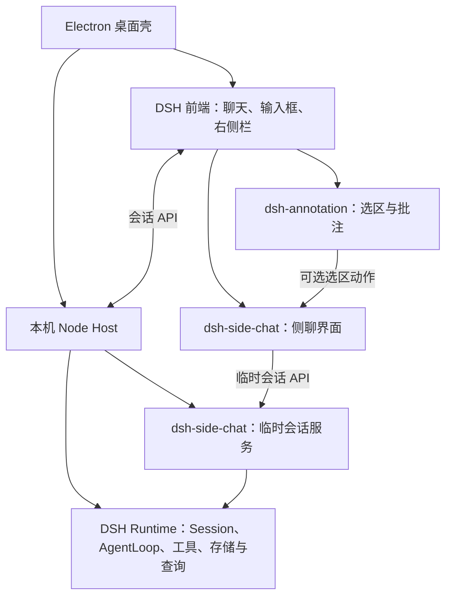

# 侧边聊天实现方案

**简体中文** | [English](README_EN.md)

本文只说明当前已实现的技术路线与效果。侧边聊天使用独立实验装配，尚未进入默认发行版，不支持转正为普通会话。交互参考 ChatGPT 风格的侧边聊天 UI，以及 `/side` 式开启旁路对话的方式。

## 功能效果

- **选段提问。** 已完成回复、中间回复和正在输出的助手文字均可选择「在侧边聊天提问」，无需等待主会话结束。摘录作为未发送批注加入右侧输入框，可继续输入、编辑或删除；光标停在批注后，原会话草稿保持不变。普通「批注」入口仍限于已完成回合的最终回复。
- **消息级入口。** 用户消息与已完成的助手回答提供「开启侧边聊天」操作，无需选段也能从指定消息开始追问。
- **上下文与记录分离。** 侧聊打开时没有消息，事件序号从 0 开始。截至入口消息的来源历史作为独立参考上下文随模型请求携带，不显示为侧聊记录；打开本身不调用模型、不执行历史任务或工具。
- **独立交互。** 主、侧会话各自输入、生成和停止。空侧聊显示「侧边聊天是临时聊天，关闭后会消失」，输入框底边按两侧统计栏实际高度对齐。
- **关闭销毁。** 原生侧栏标签的 × 取消生成并释放临时会话、消息和草稿。收起侧栏、切换主会话、隐藏窗口或长时间不活动不会结束侧聊；刷新、关闭所属窗口或退出应用会结束侧聊。已执行的文件修改和外部操作不会回滚。

同一窗口中，每个主会话可以分别保留一个侧聊。切换主会话时恢复对应的侧聊，消息、草稿、批注和关闭状态互不影响。同来源会话的后续选段加入已有侧聊，历史截断点不变；通过消息级入口更换该会话的起点前，需要先关闭它的现有侧聊。

## 与普通聊天的区别

| 关注点 | 侧边聊天 | 普通聊天 |
| --- | --- | --- |
| `session_id` | 有独立 ID、Session 与 Agent | 有独立 ID、Session 与 Agent |
| 消息记录 | 从空记录和事件序号 0 开始，只记录侧聊新增消息 | 保存本会话的消息记录 |
| 持久化 | 消息仅驻留内存；草稿、视图偏好与侧聊标签不持久保存 | 按普通会话规则保存消息与草稿 |
| 生命周期 | 显式关闭即结束，刷新或退出后不恢复 | 关闭界面后仍保留，可以再次打开 |
| 是否独立存在 | 执行状态独立；展示入口绑定来源侧栏，不支持保存后单独打开 | 可在普通会话列表中独立打开与管理 |
| 上下文继承 | 创建时截取来源历史的固定快照，单独保存在内存，不随来源后续变化 | 使用本会话历史；新建空会话不自动继承其他会话 |
| 来源依赖 | 后续请求不重新读取来源历史；附件仍依赖原资源可用性 | 依赖本会话及其引用资源 |
| 列表与搜索 | 不进入普通会话列表、历史搜索与侧栏布局恢复 | 按普通会话规则参与列表、搜索与恢复 |
| 模型与权限 | 继承截断点的模型配置，重新挂载 Agent 预设并使用当前权限 | 使用本会话的模型配置、预设与权限 |
| 长期任务 | 禁止子代理、定时任务和受限制的后台任务工具 | 按已配置的能力与权限执行 |

## 在 EduWork App 中的位置

桌面壳承载 DSH 前端并连接本机 Node Host；Host 加载 DSH Runtime 和功能插件。侧聊界面与服务分别挂载到这两层，共用现有连接与会话执行引擎。

[`dsh-side-chat`](../../../packages/dsh-side-chat/README.md) 是 `private: true` 的功能包，提供客户端和 Host 插件入口。独立成包用于隔离侧聊业务与实验装配；它运行在现有 App 和 Host 中，不增加独立应用或服务进程，也不要求单独发布 npm。

## 组件复用与新增实现

| 层次 | 复用 | 新增实现 |
| --- | --- | --- |
| 聊天界面 | `conversation.content`、`conversation.session`、`SessionProvider`、原生输入框和侧栏资源标签 | 侧聊入口、空状态、窗口控制器、批注投递与底部对齐 |
| 会话执行 | `agents.create`、`Session`、`AgentLoop`、模型调用和工具机制 | `SideChatService` 管理创建、所有权、关闭、清理重试与工具限制 |
| 来源上下文 | `sessionQuery.observeSession`、`buildForkSeed`、原生消息投影和工具历史 | 生成截断点的参考快照，单独传入新 Agent，不写入侧聊记录 |
| 批注 | 摘录编码、引用 chip、原生草稿区间操作、编辑删除与发送协议 | 注册选区动作，将同一种引用投递到侧聊输入框 |

Host 通过 `/api/eduwork/side-chat` 创建和关闭侧聊，客户端按来源会话分别持有所有权凭证。存活会话不设置租约或不活动超时，不依赖客户端定时心跳。定时清理只重试已请求关闭但清理失败的会话。刷新或窗口退出时关闭该窗口所有侧聊；异常终止导致请求未送达时，残留会话仅驻留内存，Host 退出时释放。不同主会话可以同时保留各自的侧聊，不再设置 Host 总计 8 个的限制；模型生成仍遵守全局并发规则。

## Runtime 兼容层

保留侧聊的数量与模型并发分开管理。主会话、侧聊、子代理和辅助模型请求共用 `eduwork-concurrency.maxConcurrentRequests`（默认 3，界面保存的设置优先），超出额度按同一 FIFO 队列等待；关闭排队中的侧聊会撤销其请求。名额覆盖模型流式请求，模型返回后释放，不将整轮工具执行锁在模型名额内。闲置侧聊仍持有内存上下文，但不会仅因打开就发起模型请求。

当前实验基座锁定为 DSH `0.2.1-rc.2`。兼容层只应用于实验副本，使用版本和文件哈希约束派生产物；默认 npm Runtime 与产品组件锁保持原样。主要兼容改动集中在 Runtime 的生命周期、持久化与上下文组装，侧栏展示和输入沿用原生组件。

| 兼容位置 | 实现效果 |
| --- | --- |
| Session 与 Agent 工厂 | 增加 `ephemeral` 标记，普通 Session 枚举排除临时会话 |
| AgentLoop | 跳过持久化；通过新增的 `setReferenceContext` 接收独立参考，组合当前系统提示、来源参考与侧聊新增消息 |
| 会话控制器与 JSONL 持久化 | 不广播普通会话新增事件；拒绝临时会话持久写入和普通分叉保存 |
| 客户端会话存储 | 不持久化临时草稿与视图状态；品牌会话组件使用相同规则 |
| 右侧栏布局 | 保存布局时排除侧聊标签，避免恢复失效入口 |
| Chat 用户消息操作插槽 | 提供用户消息的侧聊入口与准确消息边界 |

既有查询和搜索读取普通 Session 枚举及持久存储，沿用上述隔离规则。兼容代码集中在 [Runtime 扩展](../../../packages/dsh-side-chat/runtime-extension.mjs)和[实验构建脚本](../../../scripts/build-side-chat-experiment.mjs)。来源参考采用创建时的历史投影；当前没有针对该快照的独立压缩与预算机制。

## 与批注功能的关系及侵入范围

[`dsh-annotation`](../../../packages/dsh-annotation/README.md) 独立负责选区、摘录、批注编辑与引用协议，提供可选的客户端 `annotationSelection` 动作接口。侧聊启用时注册「在侧边聊天提问」；未注册时仍提供普通批注功能。

选区捕获仍由批注包完成。侧聊接收 `{ sourceSessionId, atSeq, reference }`，创建或复用会话，再通过原生、带草稿版本校验的引用插入事件加入目标输入框。首次挂载等待原生输入框初始化聚焦完成，保留插入后的光标位置。

批注包的业务改动集中在客户端动作注册、选区边界解析、悬浮菜单与失败提示；Host 发送协议、引用编码和持久化规则保持原样。侧聊继续复用批注编辑、删除与发送能力。流式选段不伪造消息 ID 或普通批注编号：摘录以引用传入，历史快照截至该输出之前最近的用户问题，不复制未完成输出或工具调用。已写入会话记录的中间助手消息可以使用其消息边界；后续输出不自动加入快照。主、侧会话独立生成与停止。

## 其他改动与功能边界

- 实验装配脚本组合 Runtime 扩展、侧聊包与本地批注包，记录实际组件摘要，并关闭实验包自动更新；不修改默认插件锁或发布通道。
- 既有用户消息装饰适配增加实验基座的显式版本选择，用于复用批注展示能力，通用补丁中不加入侧聊业务逻辑。
- Web Profile 适配、源码审计、包构建和验收脚本属于开发与交付工具，不参与侧聊请求执行，不增加产品服务进程。
- 当前不支持转正、嵌套侧聊、跨设备同步或崩溃恢复。侧聊沿用来源工作目录，主、侧会话可能操作同一文件；会话独立不提供文件系统隔离。
