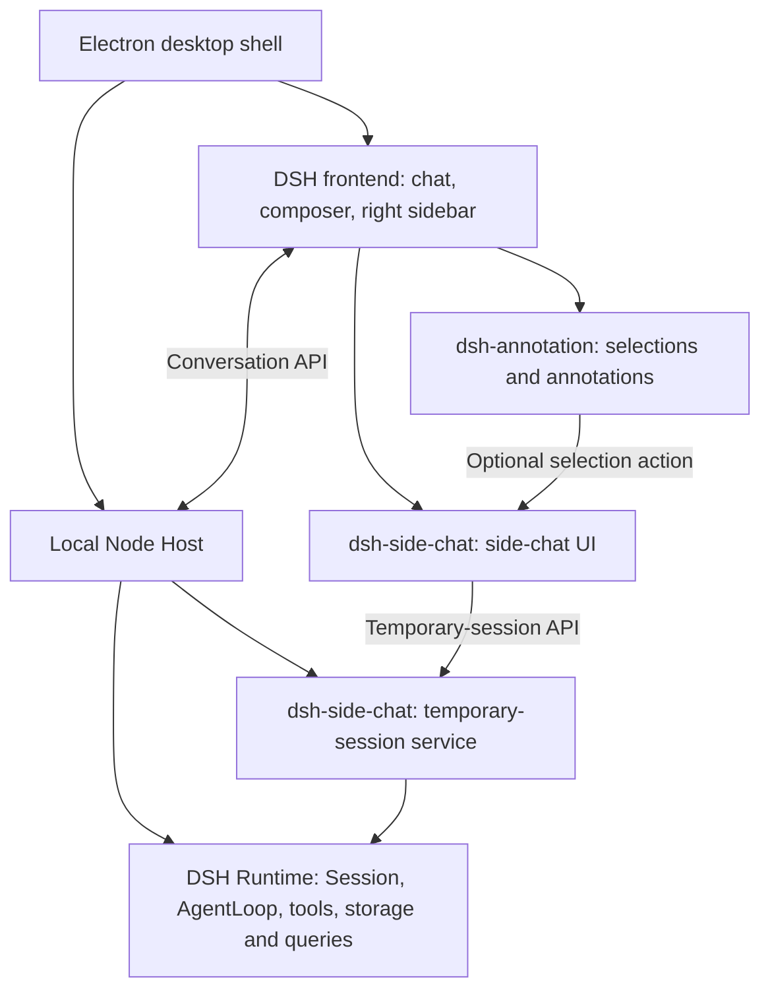

# Side Chat Implementation

[简体中文](README.md) | **English**

This document describes implemented behavior and technical boundaries only. Side chat uses an isolated experimental assembly, outside the default distribution, without promotion to an ordinary conversation. Its interaction references are ChatGPT-style side-chat UI and a `/side`-style entry for follow-up conversations.

## Behavior

- **Ask about a selection.** Completed replies, intermediate replies and streaming assistant text offer “Ask in side chat” without waiting for the main turn to finish. The excerpt becomes an unsent annotation in the right composer, available for typing, editing and deletion; the caret stays after it and the source draft is preserved. Ordinary “Annotate” remains limited to the final response of a completed turn.
- **Message actions.** User messages and completed assistant answers offer “Open side chat,” allowing a follow-up from a message without selecting text.
- **Separate context and transcript.** A side chat opens with no messages and event sequence 0. Source history through the selected message accompanies model requests as separate reference context without becoming side-chat records. Opening does not call a model or execute historical tasks or tools.
- **Independent interaction.** Main and side chats have their own input, generation and stop actions. An empty side chat shows “Side chats are temporary and disappear when closed.” Composer bottom edges align using actual footer heights.
- **Destroy on close.** The native sidebar tab's × cancels generation and releases the temporary session, messages and draft. Collapsing the sidebar, navigating between main conversations, hiding the window and inactivity do not end the chat. Refresh, closing its window or exiting the app ends the chat. Completed file changes and external actions are not rolled back.

Each main conversation in a window can retain its own side chat. Switching main conversations restores the corresponding chat; messages, drafts, annotations and closing state remain independent. Further selections from the same source join its side chat without changing the history cutoff. Changing that conversation's starting point through a message action requires closing its existing side chat first.

## Differences from Ordinary Chat

| Aspect | Side chat | Ordinary chat |
| --- | --- | --- |
| `session_id` | Independent ID, Session and Agent | Independent ID, Session and Agent |
| Transcript | Starts empty at event sequence 0; contains only new side-chat messages | Retains its conversation's message records |
| Persistence | Messages stay in memory; drafts, view preferences and side-chat tabs are not persisted | Messages and drafts follow ordinary persistence rules |
| Lifetime | Explicit close ends it; refresh and exit do not restore it | Closing its view retains it for reopening |
| Independent existence | Independent execution; its entry remains attached to the source sidebar, without saving for standalone reopening | Independently opened and managed in the ordinary conversation list |
| Context inheritance | A fixed snapshot of source history is held separately in memory and does not follow later source changes | Uses its own history; a new empty conversation does not inherit another conversation automatically |
| Source dependency | Later requests do not reread source history; attachments still require original resources to remain available | Depends on its conversation and referenced resources |
| Lists and search | Excluded from ordinary lists, history search and sidebar layout restoration | Participates in ordinary lists, search and restoration |
| Models and permissions | Inherits model settings at the cutoff, remounts the Agent preset and uses current permissions | Uses its own model settings, preset and permissions |
| Long-lived tasks | Prohibits subagents, scheduled tasks and restricted background-task tools | Uses configured capabilities and permissions |

## Position within EduWork

The desktop shell hosts the DSH frontend and connects to a local Node Host. The Host loads the DSH Runtime and feature plugins. Side chat mounts its UI and service into these layers, sharing the connection and execution engine.

[`dsh-side-chat`](../../../packages/dsh-side-chat/README_EN.md) is a `private: true` feature package with client and Host plugin entries. Its package boundary isolates the feature and its experimental assembly. It runs within the existing App and Host, adds no standalone application or service process, and requires no separate npm publication.

## Reused Components and New Code

| Layer | Reused | New implementation |
| --- | --- | --- |
| Chat UI | `conversation.content`, `conversation.session`, `SessionProvider`, native composer and sidebar resource tabs | Side-chat actions, empty state, window controller, annotation delivery and baseline alignment |
| Execution | `agents.create`, `Session`, `AgentLoop`, model requests and tools | `SideChatService` for creation, ownership, closing, cleanup retries and tool restrictions |
| Source context | `sessionQuery.observeSession`, `buildForkSeed`, native message projections and tool history | A reference snapshot at the cutoff, passed separately to the new Agent without entering its transcript |
| Annotations | Quote encoding, reference chips, native draft span operations, editing, deletion and submission protocol | A registered selection action delivering the same reference type to the side composer |

The Host creates and closes side chats through `/api/eduwork/side-chat`; the client holds an independent ownership credential for each source conversation. Open chats have no lease or inactivity timeout and do not depend on client heartbeats. Periodic cleanup only retries chats whose close was already requested. Refresh and window exit close every side chat owned by the window; if abnormal termination prevents delivery, the orphan remains only in memory until the Host exits. Different main conversations can retain their side chats concurrently, without the former Host-wide limit of eight. Model generation still follows global concurrency rules.

## Runtime Compatibility Layer

Retained side-chat count and model concurrency are separate. Main chats, side chats, subagents and auxiliary model calls share `eduwork-concurrency.maxConcurrentRequests` (default 3, with saved UI settings taking precedence). Excess requests wait in the same FIFO; closing a queued side chat cancels its request. Slots cover model streams and release when the model returns, rather than covering the entire tool-execution turn. Idle side chats retain context in memory but opening one does not itself call the model.

The experimental baseline is pinned to DSH `0.2.1-rc.2`. Version- and file-hash-guarded derivatives apply only to the experimental copy. Default npm Runtime inputs and product component locks remain unchanged. The main compatibility changes concern Runtime lifetime, persistence and context assembly; sidebar display and input reuse native components.

| Compatibility point | Effect |
| --- | --- |
| Session and Agent factories | Add the `ephemeral` marker and exclude temporary sessions from ordinary Session enumeration |
| AgentLoop | Skip durable persistence; accept separate references through the added `setReferenceContext` method and combine current system instructions, source references and new side messages |
| Session controller and JSONL persistence | Suppress ordinary session-added notifications; reject temporary-session durable writes and ordinary fork-based saving |
| Client conversation stores | Exclude temporary drafts and view state from persistence; apply the same rules to branded conversation components |
| Right-sidebar layout | Exclude side-chat tabs from saved layouts to avoid restoring expired entries |
| Chat user-message action slot | Expose the side-chat action and exact boundary on user messages |

Existing queries and search read ordinary Session enumeration and durable storage, following these isolation rules. Compatibility code lives in the [Runtime extension](../../../packages/dsh-side-chat/runtime-extension.mjs) and [experimental builder](../../../scripts/build-side-chat-experiment.mjs). Source reference context uses the history projection captured at creation; no separate snapshot-compaction or budgeting mechanism is implemented.

## Relationship to Annotations and Change Scope

[`dsh-annotation`](../../../packages/dsh-annotation/README_EN.md) independently owns selection capture, quotes, note editing and the reference protocol. It provides an optional client action registry, `annotationSelection`. Side chat registers “Ask in side chat” when enabled; ordinary annotations remain available without that registration.

Selection handling stays in the annotation package. Side chat receives `{ sourceSessionId, atSeq, reference }`, creates or reuses a chat and inserts the reference through the native revision-guarded event. First-mount delivery waits for the composer's initial focus to settle, preserving the caret after insertion.

Annotation business changes cover client action registration, selection boundary resolution, the floating toolbar and failure notices. The Host submission protocol, reference encoding and persistence rules remain unchanged. Side chat reuses annotation editing, deletion and submission. Live selections never invent message IDs or ordinary annotation badges: excerpts travel as references while history ends at the latest preceding user question, excluding incomplete output and tool calls. Durable intermediate assistant messages can use their own message boundary; later output does not enter the snapshot. Main and side conversations generate and stop independently.

## Other Changes and Boundaries

- The experimental assembler combines the Runtime extension, side-chat package and local annotation package, records component hashes and disables experimental updates. It does not change default plugin locks or release channels.
- The existing user-message decoration adapter gains explicit experimental-baseline version selection to reuse annotation display. The generic patch contains no side-chat business logic.
- Web Profile compatibility, source auditing, package builds and acceptance scripts are development and delivery tools. They do not execute side-chat requests or add product service processes.
- Promotion, nested side chats, cross-device synchronization and crash restoration are unsupported. Side chat inherits the source working directory, so both conversations may operate on the same files; independent conversations do not provide filesystem isolation.
